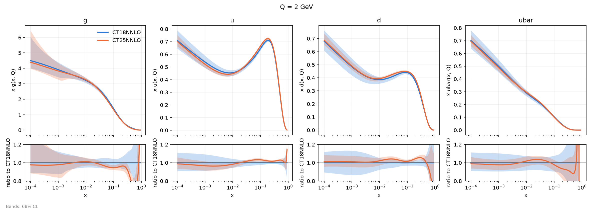
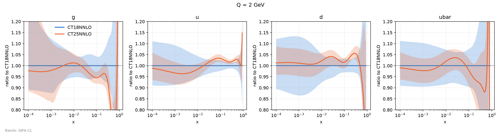

# Tutorial 1 · A basic agent that plots PDFs

You will build the smallest agent that still works: an AI agent for [Claude Code](https://claude.com/claude-code) that plots and compares parton distribution function (PDF) sets with [LHAPDF](https://www.lhapdf.org/), and changes the plot when you ask. We compare **CT18NNLO** with **CT25NNLO**.



*Q = 2 GeV, where the gluon uncertainty is large and easy to see. Top: x·f(x,Q) with 68 % CL bands. Bottom: ratio to CT18NNLO.*

## The idea

An agent that computes bands or writes plotting code on every request is slow and hard to trust. So the work is split:

> **The model decides what to run. Scripts produce the numbers.**

Four files make the agent:

| File | Role |
|---|---|
| `pdfplot.py` | `load_pdfs`, `evaluate` and `plot`, plus two small functions that draw one curve |
| `run_plot.py` | a tiny driver: reads a JSON file that describes a plot, makes it, prints numbers to quote |
| `AGENTS.md` | five rules, loaded in every session |
| `.claude/skills/plot-pdfs/SKILL.md` | the procedure for making and changing plots |

The agent's whole job is to write a small JSON file and run one command. It never touches the physics.

## 1. Setup

```bash
conda create -n pdfplot -c conda-forge python=3.11 lhapdf numpy matplotlib
conda activate pdfplot

mkdir PDFPlot && cd PDFPlot
mkdir -p pdfsets .claude/skills/plot-pdfs
```

LHAPDF is not on PyPI, but conda-forge has it. Now the PDF sets: a set is a folder named after the set, with a `.info` file and one grid file per member. **CT18NNLO** is public:

```bash
cd pdfsets
curl -O https://lhapdfsets.web.cern.ch/current/CT18NNLO.tar.gz
tar xzf CT18NNLO.tar.gz && rm CT18NNLO.tar.gz
cd ..
```

**CT25NNLO** was not on that server when this was written; get it from the CTEQ-TEA group and unpack the `CT25NNLO` folder into `pdfsets/`. Any other pair of sets works with everything below.

## 2. What is in a set

LHAPDF's `xfxQ(parton, x, Q)` returns `x·f(x,Q)`. Partons have PDG codes: 1 d, 2 u, 3 s, 4 c, 5 b, 21 gluon, negative numbers for antiquarks. A set holds many PDFs called **members**: member 0 is the central one, the others describe the uncertainty, and *how* depends on the set's `ErrorType`:

| `ErrorType` | members 1…N are | band | examples |
|---|---|---|---|
| `replicas` | random Monte Carlo replicas | mean and standard deviation | NNPDF |
| `hessian` | eigenvector pairs `(1,2), (3,4), …` | add the displacements in quadrature | CT18, CT25 |
| `symmhessian` | single eigenvector displacements | add the displacements in quadrature | MSHT20 |

Two traps, both handled in the code below:

* **mean ± std is wrong for Hessian sets.** For CT18 (gluon, x = 0.1, Q = 100 GeV) it gives a ±0.7 % band; the correct 68 % band is ±2.4 %.
* **Confidence levels differ.** CT18's eigenvectors are built for 90 %, CT25's for 68 %. To compare them we rescale to one CL. In this field **"68 %" means one sigma**, 68.268949 %, which is also the default of LHAPDF's own uncertainty routine; a CT18 band at 68 % is its native band divided by 1.645.

### How a band is computed

At one point $(x,Q)$ write $X = x\,f(x,Q)$, with $X_0$ for the central member (member 0) and $X_k$ for the others.

**Monte Carlo (`replicas`).** The $N$ replicas are samples; member 0 is not used (by convention it already is their mean):

$$\bar X=\frac{1}{N}\sum_{k=1}^{N}X_k,\qquad
\sigma_X=\sqrt{\frac{1}{N-1}\sum_{k=1}^{N}\left(X_k-\bar X\right)^{2}},\qquad
\text{band}=\bar X\pm n_\sigma(\mathrm{CL})\,\sigma_X$$

**Hessian (`hessian`).** The members come in $N$ eigenvector pairs $(X_i^{+},X_i^{-})=(X_{2i-1},X_{2i})$. The master formula gives asymmetric errors:

$$\Delta X^{+}=\sqrt{\sum_{i=1}^{N}\Big[\max\big(X_i^{+}-X_0,\;X_i^{-}-X_0,\;0\big)\Big]^{2}},\qquad
\Delta X^{-}=\sqrt{\sum_{i=1}^{N}\Big[\max\big(X_0-X_i^{+},\;X_0-X_i^{-},\;0\big)\Big]^{2}}$$

and the band is $\left[\,X_0-\Delta X^{-},\;X_0+\Delta X^{+}\,\right]$.

**Symmetric Hessian (`symmhessian`).** One member per direction:

$$\Delta X=\sqrt{\sum_{i=1}^{N}\left(X_i-X_0\right)^{2}}$$

**Confidence level.** The eigenvectors are built for the set's own level $\mathrm{CL}_\text{set}$ (90 % for CT18, 68 % for CT25). For another level the error is rescaled:

$$\Delta X(\mathrm{CL})=\frac{n_\sigma(\mathrm{CL})}{n_\sigma(\mathrm{CL}_\text{set})}\,\Delta X,\qquad
n_\sigma(\mathrm{CL})=\sqrt{2}\;\mathrm{erf}^{-1}\!\left(\frac{\mathrm{CL}}{100}\right)$$

| CL | 68.27 % ("68 %") | 90 % | 95 % |
|---|---|---|---|
| $n_\sigma$ | 1 | 1.645 | 1.960 |

**Ratio.** For a set B compared with the reference set A:

$$R(x)=\frac{X_0^{B}}{X_0^{A}},\qquad
\text{band of }R=\frac{X_0^{B}-\Delta X^{-B}}{X_0^{A}}\;\text{ to }\;\frac{X_0^{B}+\Delta X^{+B}}{X_0^{A}}$$

The reference set is drawn the same way, so it appears as the line at 1 with its own band. The uncertainty of A is not propagated into the band of B.

We do not code the Hessian formulas: LHAPDF already implements them, as `PDFSet.uncertainty(values, cl)`. We call it for Hessian and symmetric Hessian sets, and write the Monte Carlo formula ourselves because we also want to use a custom subset of replicas.

## 3. pdfplot.py

Create `pdfplot.py`. Start with the imports. `matplotlib.use("Agg")` draws straight to files, so it works with no display; `lhapdf.setVerbosity(0)` silences LHAPDF's messages.

<!-- file: pdfplot.py head -->
```python
"""Compare PDF sets with LHAPDF: load_pdfs, evaluate and plot, plus two small functions that draw one curve."""
import os
from statistics import NormalDist

import lhapdf
import matplotlib
import numpy as np

matplotlib.use("Agg")  # draw to files; works on machines without a display
import matplotlib.pyplot as plt  # noqa: E402

lhapdf.setVerbosity(0)  # silence the LHAPDF banner
```

**Load a set.** `path` is the folder that *contains* the set (or the set folder itself). It is the one thing the agent changes to "go where it is told".

<!-- file: pdfplot.py -->
```python
def load_pdfs(name, path="."):
    """Load every member of the PDF set `name`.

    `path` is the folder that contains the set folder (`path/name/name.info`).
    Passing the set folder itself (`path/name.info`) also works.
    """
    path = os.path.abspath(os.path.expanduser(path))
    if os.path.isfile(f"{path}/{name}/{name}.info"):
        folder = path
    elif os.path.isfile(f"{path}/{name}.info"):
        folder = os.path.dirname(path)  # we were given the set folder itself
    else:
        raise FileNotFoundError(f"PDF set '{name}' not found in {path}")
    lhapdf.pathsPrepend(folder)  # tell LHAPDF where to look
    return lhapdf.mkPDFs(name)   # list of members, member 0 first
```

**Evaluate.** For one flavour this returns three arrays: the central curve and the lower and upper edge of its band. There is one `if` per kind of set. A flavour is a dictionary `{PDG code: weight}`, so a valence quark is `u − ū`, computed member by member before the band is built.

Standard Hessian and symmetric Hessian sets go to LHAPDF's own routine: `pdf_set.uncertainty(values, cl)` takes the values of all members at one point and returns the central value and the errors `errplus` and `errminus`, already rescaled to the confidence level. Monte Carlo sets, and a custom subset of replicas (`members`), use the formula above. `as_cl` turns "68" into one sigma, 68.268949.

<!-- file: pdfplot.py -->
```python
# Each flavour is {PDG code: weight}. 1=d 2=u 3=s 4=c 5=b, negative = antiquark, 21 = gluon.
# A valence quark is a combination, e.g. u_v = u - ubar.
FLAVORS = {
    "g": {21: 1}, "u": {2: 1}, "d": {1: 1}, "s": {3: 1}, "c": {4: 1}, "b": {5: 1},
    "ubar": {-2: 1}, "dbar": {-1: 1}, "sbar": {-3: 1}, "cbar": {-4: 1}, "bbar": {-5: 1},
    "uv": {2: 1, -2: -1}, "dv": {1: 1, -1: -1},
}


ONE_SIGMA_CL = 68.268949  # the confidence level of one sigma: the default of LHAPDF's uncertainty()


def as_cl(cl):
    """In this field "68 %" means one sigma, 68.268949 %."""
    return ONE_SIGMA_CL if cl == 68 else cl


def n_sigma(cl):
    """How many Gaussian sigmas a confidence level in % is: 68 -> 1, 90 -> 1.645, 95 -> 1.96."""
    return NormalDist().inv_cdf(0.5 + as_cl(cl) / 200)


def evaluate(pdfs, flavor, x, Q, cl=68.0, members=None):
    """Return (central, lower, upper): x*f(x,Q) and its uncertainty band at `cl` %.

    pdfs    list of members from load_pdfs
    flavor  a key of FLAVORS, e.g. "g" or "uv"
    x       array of x values
    members for replica (Monte Carlo) sets only: use just these replica numbers (a custom subset)
    """
    if flavor not in FLAVORS:
        raise ValueError(f"Unknown flavour '{flavor}'. Valid: {', '.join(FLAVORS)}")

    # values[m, i] = x*f(x_i, Q) for member m (a combination is summed here, member by member)
    values = np.array([
        [sum(w * pdf.xfxQ(pid, float(xi), Q) for pid, w in FLAVORS[flavor].items()) for xi in x]
        for pdf in pdfs
    ])

    pdf_set = pdfs[0].set()
    error_type = pdf_set.errorType.split("+")[0]  # "replicas+as" -> "replicas"
    if members is not None and error_type != "replicas":
        raise ValueError(f"`members` only works for Monte Carlo (replica) sets; this one is '{pdf_set.errorType}'.")

    if len(values) == 1:  # one member: no uncertainty information
        central = lower = upper = values[0]

    elif error_type == "replicas":  # Monte Carlo set, e.g. NNPDF, or a custom subset: our own formula
        replicas = values[1:] if members is None else values[list(members)]
        central = replicas.mean(axis=0)
        std = replicas.std(axis=0, ddof=1)
        lower, upper = central - n_sigma(cl) * std, central + n_sigma(cl) * std

    elif error_type in ("hessian", "symmhessian"):  # standard sets, e.g. CT18, CT25: LHAPDF's own routine
        results = [pdf_set.uncertainty(list(values[:, i]), as_cl(cl)) for i in range(len(x))]
        central = np.array([r.central for r in results])
        lower = central - np.array([r.errminus for r in results])
        upper = central + np.array([r.errplus for r in results])

    else:
        raise ValueError(f"Unsupported ErrorType '{pdf_set.errorType}'")

    return central, lower, upper
```

**Draw one curve.** Plotting is split in two steps so each is easy to read. First, one small function for each kind of panel. Each one draws **one curve**, which is one set (so one colour) at one value of Q, on the axes it is given. They know nothing about loops, layouts or options, so you can read them in a minute and change one without touching the other.

Sets get colours in a fixed order, so CT18NNLO stays blue whatever else is on the plot.

<!-- file: pdfplot.py -->
```python
# One colour per set, always in this order (blue, orange, green, yellow, pink, red).
COLORS = ["#2a78d6", "#eb6834", "#1baf7a", "#eda100", "#e87ba4", "#e34948"]


def draw_pdf(ax, x, curve, color, label=None, bands=True):
    """PDF panel: draw ONE curve (one set, so one colour, at one Q) on the axes `ax`."""
    central, lower, upper = curve
    ax.plot(x, central, color=color, lw=2, label=label)
    if bands:
        ax.fill_between(x, lower, upper, color=color, alpha=0.25, lw=0)


def draw_ratio(ax, x, curve, reference, color, label=None, bands=True):
    """Ratio panel: draw the same kind of curve divided by the central value of the reference set."""
    ref = reference[0]
    ref = np.where(np.abs(ref) > 1e-30, ref, np.nan)  # avoid dividing by ~0 at large x
    central, lower, upper = curve
    ax.plot(x, central / ref, color=color, lw=2, label=label)
    if bands:
        ax.fill_between(x, lower / ref, upper / ref, color=color, alpha=0.25, lw=0)
```

* `draw_pdf` draws the central curve and its band.
* `draw_ratio` does the same after dividing by the central value of the reference set (the first one). Where the reference is about zero (large x) the ratio is left empty instead of exploding.

**Plot.** Now the function with the loops and the `if`s. It checks the options, calls `load_pdfs` and `evaluate` for every set and flavour, makes the figure with one column per flavour, and then, for every set (every colour), calls the drawing function that the kind of plot asks for. Every option of the plot is an argument with a default; this signature is the control panel the agent will use. `sets` is `{set name: folder}` and the first set is the denominator of the ratio. `show` chooses the kind of plot: the PDFs with their ratio underneath, or only the ratio.

<!-- file: pdfplot.py -->
```python
def plot(sets, flavors=("g", "u", "d", "ubar"), Q=100.0, xmin=1e-4, xmax=0.9, npoints=200,
         cl=68.0, xlog=True, ylog=False, ylim=None, show="both", ratio_ylim=(0.8, 1.2),
         bands=True, members=None, labels=None, title=None, output="plots/pdf_comparison.png"):
    """Compare PDF sets, save the figure to `output`, and return (x, curves).

    sets     {set name: folder that contains it}, e.g. {"CT18NNLO": "pdfsets", "CT25NNLO": "pdfsets"}.
             The first set is the reference of the ratio.
    show     "both": the PDFs with their ratio to the first set underneath (default)
             "ratio": only the ratio to the first set
             "pdf": only the PDFs
    members  {set name: [replica numbers]} to use only some replicas of a Monte Carlo set
    labels   {set name: legend text}
    curves   {set name: {flavour: (central, lower, upper)}}
    """
    if show not in ("both", "ratio", "pdf"):
        raise ValueError(f"show must be 'both', 'ratio' or 'pdf' (got {show!r}).")
    if len(sets) > len(COLORS):
        raise ValueError(f"At most {len(COLORS)} sets can be compared at once.")
    if not 0 < xmin < xmax <= 1:
        raise ValueError(f"Need 0 < xmin < xmax <= 1 (got {xmin}, {xmax}).")
    labels, members = labels or {}, members or {}
    x = np.geomspace(xmin, xmax, npoints) if xlog else np.linspace(xmin, xmax, npoints)

    # 1. numbers: load every set and evaluate every flavour
    curves = {}
    for name, path in sets.items():
        pdfs = load_pdfs(name, path)
        curves[name] = {f: evaluate(pdfs, f, x, Q, cl, members.get(name)) for f in flavors}

    # 2. figure. The argument `show` decides which kind of plot is made ("both", "pdf" or "ratio").
    #    It is used in three places below, each marked "show decides".
    n = len(flavors)

    # show decides (1): "both" needs two rows (PDFs on top, ratio below); "pdf" and "ratio" need one.
    #   One column per flavour in every case.
    fig, axes = plt.subplots(2 if show == "both" else 1, n, sharex="col", squeeze=False,
                             figsize=(3.8 * n + 0.6, 5.6 if show == "both" else 4.2),
                             gridspec_kw={"height_ratios": [3, 1]} if show == "both" else None)
    reference = next(iter(sets))  # the first set is the denominator of the ratio

    for col, flavor in enumerate(flavors):  # loop 1: one column per flavour
        # The panels of this column. With one row both names are the same axes.
        ax_pdf, ax_ratio = axes[0, col], axes[-1, col]

        for color, name in zip(COLORS, sets):  # loop 2: one curve per set, each set its own colour
            curve, label = curves[name][flavor], labels.get(name, name)

            # show decides (2): which drawing functions run for this curve.
            if show in ("both", "pdf"):  # a PDF panel is wanted: draw the PDF curve
                draw_pdf(ax_pdf, x, curve, color, label, bands)
            if show in ("both", "ratio"):  # a ratio panel is wanted: draw the ratio curve
                # With no PDF panel (show="ratio") the legend must come from the ratio panel.
                draw_ratio(ax_ratio, x, curve, curves[reference][flavor], color,
                           label if show == "ratio" else None, bands)

        # show decides (3): titles, labels and limits, only for the panels that exist.
        ax_pdf.set_title(flavor)
        if show in ("both", "pdf"):
            ax_pdf.set_ylabel(f"x {flavor}(x, Q)")
            ax_pdf.set_yscale("log" if ylog else "linear")
            if ylim:
                ax_pdf.set_ylim(*ylim)
        if show in ("both", "ratio"):
            ax_ratio.axhline(1, color="gray", lw=0.8)  # the line ratio = 1
            if ratio_ylim:
                ax_ratio.set_ylim(*ratio_ylim)
            ax_ratio.set_ylabel(f"ratio to {labels.get(reference, reference)}")

        # The same for every kind of plot: the x axis, which is the bottom panel of the column.
        ax_ratio.set_xlabel("x")
        ax_ratio.set_xscale("log" if xlog else "linear")
        for ax in axes[:, col]:
            ax.grid(alpha=0.2)
    axes[0, 0].legend(frameon=False)

    fig.suptitle(title or f"Q = {Q:g} GeV")
    fig.text(0.01, 0.01, f"Bands: {cl:g}% CL" if bands else "Central values only",
             fontsize=8, color="gray")
    fig.tight_layout(rect=(0, 0.03, 1, 1))
    os.makedirs(os.path.dirname(os.path.abspath(output)), exist_ok=True)
    fig.savefig(output, dpi=150)
    plt.close(fig)
    return x, curves
```

This is where the kind of plot is decided. The argument `show` is used in three places, each marked `show decides` in the comments: (1) how many rows the figure has, (2) which drawing function runs for each curve, (3) which titles, labels and limits are set. The two loops are: one column per flavour, and inside it one curve per set. To add a new kind of panel, write a `draw_...` function for one curve and add one `if` in place (2).

Try it:

```bash
python -c 'from pdfplot import plot; plot({"CT18NNLO": "pdfsets", "CT25NNLO": "pdfsets"}, Q=2)'
```

This writes `plots/pdf_comparison.png`, the figure at the top.

### Two kinds of plot

Often you do not need the curves, only how much one set differs from the other. `show="ratio"` draws just that: one panel per parton, the reference set as the line at 1 with its own band, and the other sets relative to it.

```bash
python -c 'from pdfplot import plot; plot({"CT18NNLO": "pdfsets", "CT25NNLO": "pdfsets"}, Q=2, show="ratio", output="plots/ratio.png")'
```



| `show` | You get |
|---|---|
| `"both"` (default) | the PDFs, with their ratio to the first set underneath |
| `"ratio"` | only the ratio to the first set |
| `"pdf"` | only the PDFs |

The agent will pick the kind from your request ("show only the ratio") by editing one key of the plot file (section 4 explains the file).

## 4. The plot file and run_plot.py

The agent will not write Python. Instead of code it writes a small text file, `plot.json`, that **describes the plot you want**. A second script, `run_plot.py`, reads that file and makes the plot. This is the part people find confusing, so here it is slowly.

### What plot.json is

JSON is a plain text format for a list of `"name": value` pairs. This is a whole plot file:

```json
{
  "sets": {"CT18NNLO": "pdfsets", "CT25NNLO": "pdfsets"},
  "flavors": ["g", "u"],
  "Q": 2
}
```

Each **name** is one of the arguments of the function `plot` that you wrote in section 3, spelled exactly the same: `sets`, `flavors`, `Q`, `show`, `cl`, and so on. Each **value** is what you would pass for it. So the file above says the same as this Python call:

```python
plot(sets={"CT18NNLO": "pdfsets", "CT25NNLO": "pdfsets"}, flavors=["g", "u"], Q=2)
```

An argument that is not in the file keeps the default from `def plot(...)`: here `show="both"`, `cl=68`, and so on. That is why the file can be so short.

### How it travels

```text
 plot.json ──► run_plot.py ──► json.load ──► a Python dictionary ──► plot(**config) ──► plots/pdf_comparison.png
 text file     the driver      reads it       {"Q": 2, ...}           the function        the picture
 (agent or you                                                        you wrote
  writes it)
```

1. **Someone writes the file.** You can type it in any editor, or with `echo` as below. The agent writes it with its file tool, because writing a text file is something it can already do. Nothing else is stored anywhere: the file *is* the record of the plot, and running it again gives the same figure.
2. **`run_plot.py` reads it.** `json.load` turns the text into a Python *dictionary*.
3. **`plot(**config)` runs.** The two stars mean: take every `key: value` of the dictionary and pass it as `key=value`. This is the line that connects the file to your function.
4. **`plot` saves the picture** where the file's `output` says (`plots/pdf_comparison.png` if the file does not say).

You can do steps 2 and 3 by hand to see it:

```python
>>> import json
>>> config = json.load(open("plot.json"))
>>> config
{'sets': {'CT18NNLO': 'pdfsets', 'CT25NNLO': 'pdfsets'}, 'flavors': ['g', 'u'], 'Q': 2}
>>> from pdfplot import plot
>>> x, curves = plot(**config)       # the same as writing every argument out
```

JSON writes a few values differently from Python:

| In `plot.json` | Python | Example |
|---|---|---|
| `"text"` | string | `"CT18NNLO"` |
| `2`, `0.5` | number | `"Q": 2` |
| `true`, `false` | `True`, `False` | `"bands": false` |
| `null` | `None` | `"ratio_ylim": null` |
| `["g", "u"]` | list | `"flavors": ["g", "u"]` |
| `{"a": "b"}` | dictionary | `"sets": {...}` |

### Why a file and not code

Because the agent's job becomes small and safe: edit one text file and run one command, instead of writing and debugging Python. A request like "now show only the ratio" changes one line of the file, `"show": "ratio"`, and nothing else.

### The driver

`run_plot.py` does exactly the steps above, and then prints numbers: for each flavour and set, the ratio to the first set and the half-width of the band at a few x values. The agent quotes that table instead of guessing from the picture.

<!-- file: run_plot.py whole -->
```python
"""python run_plot.py plot.json: make the plot described by the file and print numbers to quote."""
import json
import sys

import numpy as np

from pdfplot import plot

# 1. Read the JSON file named on the command line (python run_plot.py plot.json) into a dictionary.
config = json.load(open(sys.argv[1]))
# 2. `**` hands every key of the dictionary to plot() as an argument: "Q": 2 becomes Q=2.
x, curves = plot(**config)
print("Saved", config.get("output", "plots/pdf_comparison.png"))

first = next(iter(config["sets"]))  # the first set is the reference of the ratios
for flavor in curves[first]:
    for name in config["sets"]:
        cells = []
        for xi in (0.001, 0.01, 0.1, 0.5):
            central, lower, upper = (np.interp(np.log(xi), np.log(x), c) for c in curves[name][flavor])
            ref = np.interp(np.log(xi), np.log(x), curves[first][flavor][0])
            cells.append(f"x={xi:g}: ratio {central / ref:.3f}, band +-{50 * (upper - lower) / abs(central):.1f}%")
        print(f"[{flavor}] {name}: " + " | ".join(cells))
```

Write a plot file and run it (this is the same file as above):

```bash
echo '{"sets": {"CT18NNLO": "pdfsets", "CT25NNLO": "pdfsets"}, "flavors": ["g", "u"], "Q": 2}' > plot.json
python run_plot.py plot.json
```

```text
Saved plots/pdf_comparison.png
[g] CT18NNLO: x=0.001: ratio 1.000, band +-12.2% | x=0.01: ratio 1.000, band +-5.0% | x=0.1: ratio 1.000, band +-4.6% | x=0.5: ratio 1.000, band +-18.8%
[g] CT25NNLO: x=0.001: ratio 0.979, band +-14.0% | x=0.01: ratio 1.012, band +-4.2% | x=0.1: ratio 0.945, band +-2.9% | x=0.5: ratio 0.737, band +-15.3%
[u] CT18NNLO: ...
```

At Q = 2 GeV the gluon band is wide at small x (about ±12 % at x = 0.001). At x = 0.5 the CT25 gluon is 26 % below CT18.

Now change one line of the file and run it again, as the agent will: add `"show": "ratio"` to `plot.json`.

```bash
echo '{"sets": {"CT18NNLO": "pdfsets", "CT25NNLO": "pdfsets"}, "flavors": ["g", "u"], "Q": 2, "show": "ratio"}' > plot.json
python run_plot.py plot.json
```

The printed numbers are the same, but `plots/pdf_comparison.png` now shows only the ratio. One key of the file decided which plot was made.

## 5. AGENTS.md: the rules

Claude Code loads `AGENTS.md` at the start of every session. (Claude Code reads `AGENTS.md` directly from version 2.1.277. With an older version, or if the folder also has a `CLAUDE.md`, put the single line `@AGENTS.md` in a `CLAUDE.md`, as tutorial 2 does.) Keep it short: each line costs context in every session. Rule 1 is the one the whole design rests on.

<!-- file: AGENTS.md whole -->
````markdown
# AGENTS.md

You plot and compare parton distribution function (PDF) sets with LHAPDF, using the tested code in this folder. Run inside the conda environment `pdfplot`.

1. **Never compute PDFs, bands or ratios yourself.** Every number comes from `python run_plot.py`.
2. **A plot is a file.** To make or change a plot, write or edit `plot.json` and run `python run_plot.py plot.json`. Keep every setting the user did not ask to change.
3. **Never guess where a set is.** Ask the user for the folder that contains it.
4. **Look before answering.** Open the PNG in `plots/`, fix problems, and quote the table the script prints.
5. **Do not edit `pdfplot.py` or `run_plot.py`** unless the user asks.
````

## 6. The skill: the procedure

A skill is a folder with a `SKILL.md`. The `description` in its header tells Claude Code **when** to load it, so write it as "use when…". The body is the procedure, and the options table is the agent's menu: it matches the arguments of `plot`.

Create `.claude/skills/plot-pdfs/SKILL.md`:

<!-- file: .claude/skills/plot-pdfs/SKILL.md whole -->
````markdown
---
name: plot-pdfs
description: Plot or compare LHAPDF parton distribution function (PDF) sets such as CT18NNLO, CT25NNLO or NNPDF, or change an existing PDF plot (Q, flavours, confidence level, ratio only, axes). Use when the user asks to plot, compare or modify PDFs.
---

# plot-pdfs

Goal: a plot made by the tested code, looked at, and explained with the numbers the script printed.

## Steps

1. **Find out where each set is.** The user gives a folder, or you ask. Check that `<folder>/<NAME>/<NAME>.info` exists. Never guess.
2. **Write `plot.json`.** Its keys are the options below; `sets` is required and maps each set name to the folder that contains it. For a change request, edit the existing file and change only what was asked.
3. **Run it:** `python run_plot.py plot.json`. It saves the PNG in `plots/` and prints, for each flavour and set, the ratio to the first set and the band half-width at a few x values.
4. **Open the PNG** (`plots/<output>`). Fix clipped curves or a ratio range that hides the curves by editing `plot.json` and running again.
5. **Report** in a few lines: what you plotted, the file, what stands out, quoting the printed table.

If the script fails, read the error: `PDF set 'X' not found in ...` means a wrong folder; ask the user.

## Options (keys of `plot.json`; defaults in parentheses)

| key | meaning |
|---|---|
| `sets` | `{"CT18NNLO": "pdfsets", "CT25NNLO": "pdfsets"}`; the **first** set is the denominator of the ratio panels; at most 6 sets |
| `flavors` | `g u d s c b ubar dbar sbar cbar bbar uv dv` (`["g","u","d","ubar"]`) |
| `Q` | scale in GeV (100) |
| `xmin`, `xmax`, `npoints` | x range and number of points (1e-4, 0.9, 200); keep `xmin` at or below 0.001 and `xmax` at or above 0.5 so the printed table covers its x values |
| `cl` | confidence level of the bands in % (68) |
| `xlog`, `ylog`, `ylim` | axis scales (true, false) and y limits such as `[0, 2]` |
| `show` | kind of plot: `"both"` the PDFs with their ratio to the first set underneath (default), `"ratio"` **only the ratio**, `"pdf"` only the PDFs |
| `ratio_ylim` | y range of the ratio, `[0.8, 1.2]` by default; `null` for automatic. Widen it if curves are clipped (large x, low Q) |
| `bands` | draw uncertainty bands (true) |
| `members` | Monte Carlo sets only: `{"NNPDF40_nnlo_as_01180": [1, 2, 3]}` uses only those replicas |
| `labels`, `title` | legend text `{"CT25NNLO": "CT25"}` and figure title |
| `output` | file to save (`plots/pdf_comparison.png`) |

Researchers often want only the ratio between the sets: set `"show": "ratio"`. To go back to the PDFs with the ratio underneath, set `"show": "both"`.

If the user wants something that is not an option (a dark theme, a line width), say it needs a change in `pdfplot.py`.
````

## 7. Use it

Start Claude Code in the project folder, with the environment active:

```bash
conda activate pdfplot
claude
```

Try, in this order:

```text
> Compare CT18NNLO and CT25NNLO for the gluon and the up quark at Q = 2 GeV. The sets are in ./pdfsets.
> Use 90% bands and widen the ratio panel to 0.7 - 1.3.
> Now show only the ratio, without the PDFs.
> Add the d-bar quark.
> Which set has the smaller gluon uncertainty at x = 0.5?
> My other sets are in ~/data/lhapdf. Compare CT18NNLO with NNPDF40_nnlo_as_01180.
```

What to expect for the first request (the wording varies; this is the sequence of steps, not a recording):

```text
● skill plot-pdfs
● Write(plot.json)
● Bash(python run_plot.py plot.json)
● Read(plots/pdf_comparison.png)
Both sets agree within their bands. At x = 0.1 the CT25 gluon is ~5% below CT18 (ratio 0.945)
with a narrower band (+-2.9% vs +-4.6%); at x = 0.5 it is ~26% below (ratio 0.737).
```

After the first request, open `plot.json`: it is the plot. After the second, only `cl` and `ratio_ylim` changed; after the third, only `"show": "ratio"` was added. The last request is the point of the design: you only said *where*, and the agent edited a path.

## What you have, and what it lacks

You have a **single agent** (one model, a few tools, one set of instructions) working in a loop: reason, run a command, read the result, decide what next.

It is deliberately small, and it has weak spots:

* nothing stops the agent from doing arithmetic itself, or editing `pdfplot.py`;
* a wrong path or option is only caught when Python fails;
* it does not remember where your sets are between sessions;
* it does not say what it can do when you start it.

[Tutorial 2](2-complete/00-overview.md) fixes these, one layer at a time: a stronger driver and tests, rules, examples and docs, the agent's welcome message with its capabilities and skills, and permissions.
