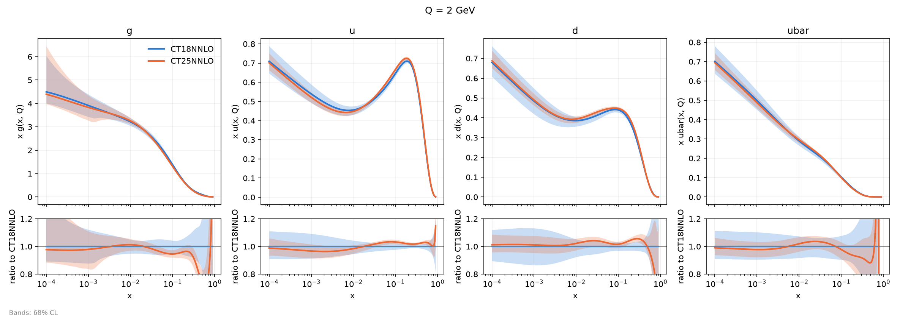

# Tutorial 2 · From a basic agent to a complete one

[Tutorial 1](../1-basic.md) gave you the smallest agent that works: `pdfplot.py`, `run_plot.py`, a five-line `AGENTS.md` and one skill. This tutorial adds, one layer at a time, what makes an agent **reliable enough to hand to someone else**.



Do tutorial 1 first. Everything here builds on its files, and each chapter says which file it replaces and which it adds.

## The principle does not change

> **The model decides what to run. Scripts produce the numbers.**

What changes is how well that principle is **enforced and documented**. In Google Cloud's vocabulary the agent stays a *single agent* working in a *ReAct* loop; the new layers add a *human in the loop* (it asks before anything that matters) and make its behaviour predictable.

## What each layer fixes

| Weak spot of tutorial 1 | Layer | Chapter |
|---|---|---|
| A wrong option is only caught when Python fails; nothing records where a set came from | a stronger driver and tests | [01](01-driver-and-tests.md) |
| Hard-won knowledge (Hessian vs mean ± std, CL rescaling, same name two grids) lives only in your head | `rules/` | [02](02-rules.md) |
| The agent can present an unchecked comparison as a result; no one knows what does not work | `examples/` and `docs/LIMITATIONS.md` | [03](03-examples-and-docs.md) |
| It forgets where your sets are; one skill does everything | a fuller `AGENTS.md`, `CLAUDE.md`, two skills, `local/` | [04](04-instructions.md) |
| It does not say what it can do when you start it | `docs/CAPABILITIES.md`, a `welcome` skill, a launcher | [05](05-welcome-and-skills.md) |
| Nothing stops it from editing the code, downloading, or deleting | `.claude/settings.json` | [06](06-guard-rails.md) |

## The finished layout

```text
PDFPlot/
├── AGENTS.md  CLAUDE.md          behaviour, always loaded
├── pdfplot  (launcher)           starts the agent with its welcome
├── pdfplot.py  run_plot.py       the deterministic toolchain
├── .claude/
│   ├── settings.json             permissions: allow, ask, deny
│   └── skills/{welcome,find-pdf-sets,plot-pdfs}/SKILL.md
├── rules/       determinism.md  error_types.md  set_paths.md
├── examples/    ct18-vs-ct25.md
├── docs/        CAPABILITIES.md  LIMITATIONS.md
├── tests/       test_pdfplot.py
├── pdfsets/     (your PDF sets)
├── local/       sets.md  <plot>.json      created by the agent, git-ignored
└── plots/                                  created by the driver
```

## Which layers you may omit

| Layer | Importance | You can omit it when |
|---|---|---|
| `AGENTS.md`, a skill, the scripts | essential | never |
| `rules/` | recommended | there are only one or two; fold them into `AGENTS.md` |
| `examples/` | recommended | you have one workflow; fold it into the skill |
| `docs/` | recommended | a README section says what does and does not work |
| `.claude/settings.json` | recommended | nothing the agent can do is costly |
| `local/` | recommended | one person, one machine |
| welcome skill, capabilities, launcher | optional | only you use it |

Each chapter ends with a **checkpoint**. If you want to stop earlier, every chapter leaves a working agent.

Next: [01 A stronger driver and tests →](01-driver-and-tests.md)
