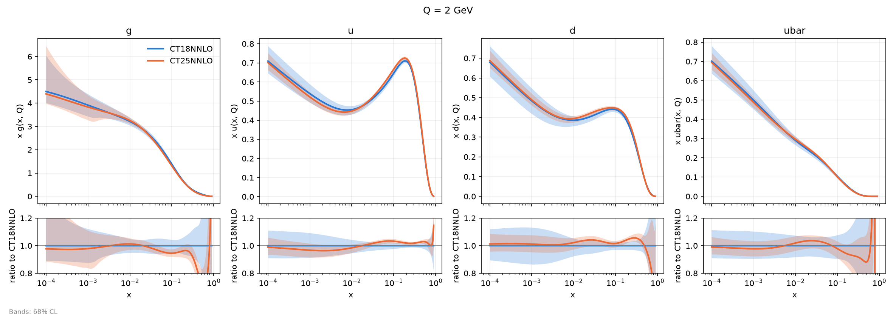

# Build an AI agent that plots PDFs

Two short tutorials that build an AI agent for [Claude Code](https://claude.com/claude-code). The agent finds parton distribution function (PDF) sets on your machine, compares them with [LHAPDF](https://www.lhapdf.org/) (we use **CT18NNLO** vs **CT25NNLO**), and changes the plot when you ask.

It makes two kinds of plot: the PDFs with their ratio underneath, or only the ratio between the sets (the one researchers ask for most). The agent is a set of files, not a program that calls an API. **The model decides what to run; the scripts produce the numbers.**

## Start with the basic one

| | | You build |
|---|---|---|
| **1** | [Basic agent](1-basic.md) | the smallest agent that works: `pdfplot.py` (load, evaluate, plot), a tiny driver, five rules, one skill. |
| **2** | [Complete agent](2-complete/00-overview.md) | adds, one chapter each, what makes it reliable enough to share |

Tutorial 2 chapters:

| Chapter | Adds |
|---|---|
| [01 A stronger driver and tests](2-complete/01-driver-and-tests.md) | input checks, provenance, tests |
| [02 Rules](2-complete/02-rules.md) | `rules/`: what must never go wrong |
| [03 Examples and docs](2-complete/03-examples-and-docs.md) | `examples/` with a validation status, `docs/LIMITATIONS.md` |
| [04 Instructions](2-complete/04-instructions.md) | fuller `AGENTS.md`, `CLAUDE.md`, two skills, `local/` |
| [05 The welcome message, capabilities and skills](2-complete/05-welcome-and-skills.md) | what the agent says when it starts, what it can do, its skill list, a launcher |
| [06 Guard rails](2-complete/06-guard-rails.md) | `.claude/settings.json` permissions |

## What you need

* `conda` on Linux or macOS (LHAPDF comes from conda-forge) and basic Python.
* Claude Code, to run the agent. No API key is needed.
* The CT18NNLO set and CT25NNLO can be found in the [CTEQ-TEA-Official-website](https://cteq-tea.gitlab.io/project/00pdfs/).
